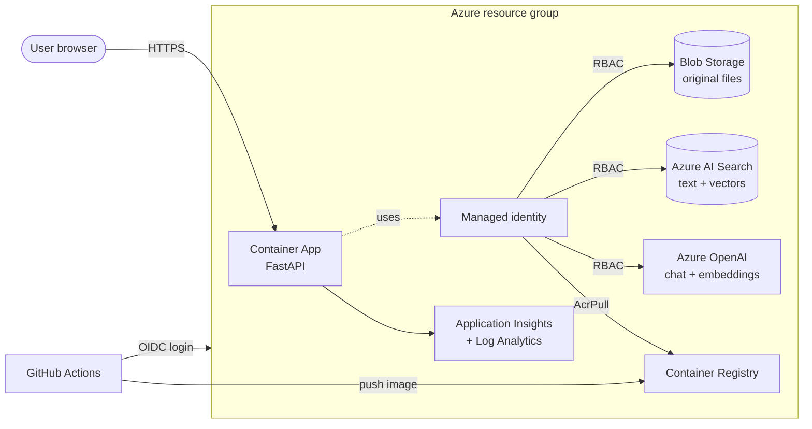

# Architecture

## Upload flow

1. The user uploads a PDF, TXT or MD file.
2. The app saves the original file in Blob Storage.
3. The app extracts the text and splits it into chunks of about 1,000 characters (200 overlap).
4. Azure OpenAI makes an embedding (a vector) for each chunk.
5. The app stores each chunk and its vector in Azure AI Search.

## Question flow (RAG: retrieval-augmented generation)

1. The app makes an embedding for the question.
2. Azure AI Search does a hybrid search: keyword search and vector search together.
3. The app sends the 5 best chunks and the question to the chat model.
4. The model answers from those chunks only and cites them as [1], [2], ...

## Security decisions

| Decision | Why |
|---|---|
| Managed identity + RBAC for all data access | No keys or passwords in code or settings |
| `disableLocalAuth` on OpenAI and Search, `allowSharedKeyAccess: false` on Storage | Keys cannot be used even if leaked |
| GitHub OIDC login | No Azure secret stored in GitHub |
| Pipeline has Owner on one resource group only | Least privilege at subscription level |
| Container runs as a non-root user | Smaller attack surface |
| Answers are shown with `textContent` | Prevents HTML/script injection from model output |

## Cost decisions

- Container App scales to zero when idle.
- Basic tiers for Container Registry and AI Search; AI Search can use the `free` tier.
- Log retention is 30 days.
